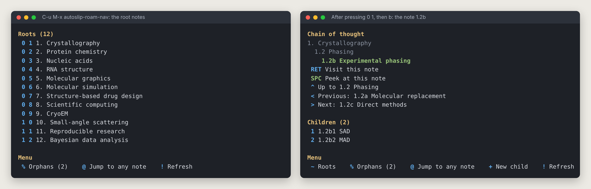
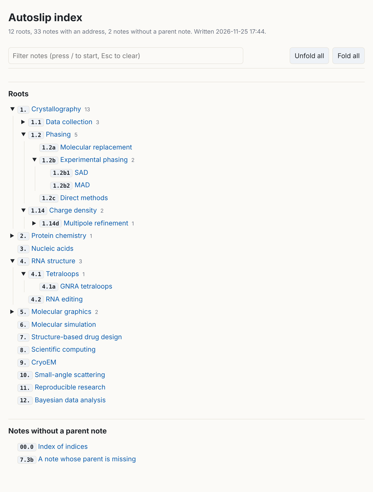

# Autoslip-Roam

[](https://www.gnu.org/licenses/gpl-3.0)
[](https://www.gnu.org/software/emacs/)
[](https://www.orgroam.com/)

Automatic folgezettel (computer-compatible Luhmann-style) bidirectional link generation for [org-roam](https://www.orgroam.com/).
This package uses the folgezettel index to determine parent-child relationships and automatically creates directional links based on those relationships.
The index appears before the note title and works with the org-roam file-naming system.
It also supports printing the note for storage in a paper zettelkasten.
Although the zettelkasten grows organically as new notes are inserted anywhere in the knowledge graph, the index determines the linear order of notes for paper storage.

## What problems are addressed by this plugin?

### True automation of bidirectional linking
Electronic zettelkasten rely on reciprocal hyperlinks to relate parent and child notes. 
Manually inserting these links is error-prone and time-consuming. 
This package automates link creation by leveraging the parent-child relationship defined in the indexing system. 
You do not need to click a button to add the links; they are added automatically, out of sight and out of mind.

### Bridge to a paper-based zettelkasten
The folgezettel index determines the order in which a new note is to be placed in a series of notes in a paper-based zettelkasten.
Printing these indicates a bridge between electronic and paper-based zettelkasten.
This bridge supports hybrid, mirror, and project-based approaches.
In the project-based approach, you use paper notes while assembling a manuscript, ordering and rearranging them on a physical tabletop or corkboard.

Most electronic zettelkastens rely either on timestamps or a database ID to identify each unique note. 
This approach fails if you want to print your zettels to store them in a paper-based zettelkasten. 
Fans of the paper-based approach may object to printed zettels; they argue you should write these notes by hand to better integrate the information into your memory. 
This may be true, but more frequent perusal of the paper zettelkasten may compensate and be more effective in the long term. 

Often, there isn't enough time to rewrite all the notes by hand.
Nor is there time to convert handwritten notes into an electronic format.
There is no rule against mixing handwritten and printed notes together. 
Spending time frequently perusing the notes, not the format of the notes, is the main limiting factor to the successful use of  a zettelkasten as a tool for thinking.


The inclusion of the folgezettel index in the title indicates where to store the note. 
Paper-based zettelkastens rely on the folgezettel index (or alternatively the Luhmann-style index or the Scott Scheper index, neither of which is computer-compatible) to specify the linear order of note storage. 
A one-to-one mapping exists between the zettelkasten graph and the order in which the notes are stored.

This approach supports a hybrid zettelkasten, with part electronic and part paper-based. 
Of course, it also supports a mirrored zettelkasten in both paper and electronic form.

You can print a note on US letter-size paper, fold it in half with the title facing outward, and store it in this zettelkasten. 
This folded paper is roughly A5-sized. 
Luhmann used the smaller A6-sized paper.

If a note spans multiple pages, as may happen with a structure, keyword, or hub note, you can fold the pages in half together. 
You can also save paper and space by printing double-sided, resulting in a booklet with two pages per side. 
For example, an eight-page note would span both sides of two sheets of US letter paper. 
The text will be rotated by 90°, so you will need to write the index across the top of the outside side of the folded paper. 

I favor this approach over index cards because it provides more space and US Letter printer paper is cheaper and more readily available. 
This more practical approach reduces the friction of adding new notes to your paper-based zettelkasten.

Obsidian offers a fantastic, infinite canvas for displaying and organizing notes in all kinds of configurations. 
The ability to print notes lets you work with paper versions on a large tabletop or corkboard. 
Sometimes, switching from electronic to physical can stimulate the mind. 
This alternative physical approach to arranging notes is useful when assembling a manuscript. 
You can use the canvas to combine all the notes you want to print. 
This could be useful for one-off tasks, such as assembling a manuscript, where you may discard the paper notes when you are done.

### Adding some order to the zettelkasten
Some hierarchical order is necessary to make the zettelkasten easier to navigate because keyword searching doesn't guarantee you will retrieve all relevant notes. 
Luhmann's paper version used an indexing system to provide order. 
Cross-links between notes provided disorder. 
According to Luhmann, you need both order and disorder. 
The optimal mix of order and disorder will probably vary with project and user. 
Luhmann's indexing system started with root nodes numbered with integers, separated by backslashes from the indices of the descendant nodes. 

When starting a zettelkasten, I recommend spending an hour or more identifying the areas of knowledge you want to store notes on. 
These areas can serve as your root nodes. 
You can expand this list as your interests evolve.

## Table of Contents

- [Overview](#overview)
- [Features](#features)
- [Installation](#installation)
- [Quick Start](#quick-start)
- [Folgezettel Address Format](#folgezettel-address-format)
- [Usage](#usage)
- [Configuration](#configuration)
- [Commands](#commands)
- [Transient Navigation Menu](#transient-navigation-menu)
- [Browser Dashboard](#browser-dashboard)
- [Repairing Links](#repairing-links)
- [Testing](#testing)
- [Info Documentation](#info-documentation)
- [Troubleshooting](#troubleshooting)
- [Contributing](#contributing)
- [License](#license)

## Overview

Autoslip-roam brings the folgezettel numbering system to org-roam. 
When you create a note with a folgezettel address in its title (e.g., "1.2a My Topic"), the package automatically:

1. Identifies the parent note based on the address hierarchy.
2. Inserts a backlink to the parent in the new note.
3. Inserts a forward link to the child in the parent note.

This creates a navigable hierarchy of interconnected notes.

## Features

- **Automatic Bidirectional Linking** - Parent and child notes are linked automatically.
- **Narrowing of Search Results in Minibuffer** - The index narrows the search results in the minibuffer as it is extended, thereby facilitating movement down the chain of thought.
- **Address Validation** - Prevents invalid folgezettel addresses.
- **Duplicate Detection** - Warns if an address is already in use.
- **Smart Suggestions** - Suggests the next available child address.
- **Cross-Reference Links** - Automatic reciprocal links when inserting manual links.
- **Database Sync** - Immediate visibility in org-roam graph and queries.
- **Extended Alphabet** - Supports aa, ab, ..., zz, aaa, ... after z.
- **Navigation Commands** - Jump to parent, list children, or show a tree view of the vault.
- **Chain of Thought** - Show every ancestor from the current note to its root in a dedicated buffer, and optionally insert that chain into the current note.
- **Cross-linked Chains of Thought** - For every note linked under Cross References, show its own ancestor chain so the cross-link is understood in context rather than by name alone.
- **Reparenting** - Move a note (or a whole subtree) to a new folgezettel address, with links and file names kept in sync.
- **Quiet Link Storage** - Optional property-drawer mode that keeps parent and child references out of the visible body of the note, reducing merge-conflict surface.
- **Transient Navigation Menu** - Walk the hierarchy in a menu that shows the chain of thought, the neighboring notes, and the children of the current note at once. The first screen lists the root notes.
- **Browser Dashboard** - Write the whole hierarchy to one HTML page with a foldable tree, a filter box, and links back to the notes.
- **Link Repair** - Scan the vault and add every missing parent or child link in one step. Links that are already there are left alone.
- **Index Backlinks** - Link a root note, or every root note, back to the index of indices (`00.0`).
- **Lisp Entry Point** - Create a child note from other packages with `autoslip-roam-create-child`. The companion package [autoslip-noter](https://github.com/MooersLab/autoslip-noter) uses it to file org-noter notes on PDF files.

## Installation

### Requirements

- Emacs 27.1 or later
- org-roam 2.0 or later

The two optional files, `autoslip-roam-nav.el` (transient menu) and `autoslip-roam-html.el` (browser dashboard), need Emacs 28.1 or later and transient 0.4.0 or later. Transient is built into Emacs from version 28.

### From MELPA (Recommended)

Once available on MELPA:

```elisp
M-x package-install RET autoslip-roam RET
```

### Manual Installation

1. Clone the repository:

```bash
git clone https://github.com/MooersLab/autoslip-roam.git
cd autoslip-roam
```

2. Add to your Emacs configuration:

```elisp
(add-to-list 'load-path "/path/to/autoslip-roam")
(require 'autoslip-roam)
(autoslip-roam-mode 1)
```

### Using use-package

```elisp
(use-package autoslip-roam
  :after org-roam
  :load-path "/path/to/autoslip-roam"
  :config
  (autoslip-roam-mode 1)
  :bind
  (:map org-mode-map
        ("C-c n c" . autoslip-roam-insert-next-child)
        ("C-c n p" . autoslip-roam-add-backlink-to-parent)))
```

## Quick Start

### 1. Enable the Mode

```elisp
(require 'autoslip-roam)
(autoslip-roam-mode 1)
```

### 2. Create a Root Note

```
M-x org-roam-node-find RET
Title: 1. Introduction to My Topic
```

Root note titles carry a trailing period after the integer (e.g., `1.`), matching the style used in numbered outlines like `1. Crystallography`. 
Legacy titles without the trailing period (e.g., `1 Introduction`) are still recognized and are treated as equivalent to the canonical form.

### 3. Create a Child Note

With the root note open:

```
M-x autoslip-roam-insert-next-child RET
```

The package suggests `1.1` as the first child. Enter a title when prompted.

### 4. Verify the Links

**Child note (1.1 First Subtopic):**
```org
#+title: 1.1 First Subtopic

** Parent Note
[[id:abc123][Parent note]]

Your content here...
```

**Parent note (1. Introduction to My Topic):**
```org
#+title: 1. Introduction to My Topic

Your content here...

** Child Notes
[[id:def456][1.1 First Subtopic]]
```

## Folgezettel Address Format

### Address Hierarchy

| Address | Description |
|---------|-------------|
| `1.` | Root note |
| `1.2` | Second subtopic of note 1 |
| `1.2a` | First letter branch of 1.2 |
| `1.2aa` | 27th child of 1.2 (after z) |
| `1.2a3` | Third numeric child of 1.2a |
| `1.2a3b` | Second letter child of 1.2a3 |

### Rules

1. **Start with a number** - All addresses begin with a root number
2. **Root notes carry a trailing period** - Canonical root form is `N.` (e.g., `1.`). Legacy bare-integer titles (`1 Crystallography`) are still accepted and treated as equivalent.
3. **Single period only** - Only one `.` allowed (the one separating the root from the first subtopic, or the one marking a root note itself)
4. **Alternation** - Numbers and letters must alternate after the period
5. **Lowercase only** - Use lowercase letters (a-z)
6. **Extended alphabet** - After z comes aa, ab, ..., zz, aaa, ...

### Parent-Child Relationships

| Child | Parent | Rule |
|-------|--------|------|
| `1.2` | `1.` | Remove `.number`, leave the root period |
| `1.2a` | `1.2` | Remove letters |
| `1.2aa` | `1.2` | Remove ALL trailing letters |
| `1.2a3` | `1.2a` | Remove trailing numbers |

## Usage

### Creating Child Notes

The recommended workflow:

```
M-x autoslip-roam-insert-next-child
```

This command:
1. Extracts the current note's folgezettel address
2. Suggests the next available child address
3. Creates the note with automatic bidirectional links

### Adding Links to Existing Notes

For notes created without automatic linking:

```
M-x autoslip-roam-add-backlink-to-parent
```

A link that is already there is left alone, so the command is safe to run twice.
To repair the whole vault in one step, see [Repairing Links](#repairing-links).

### Validating Addresses

Check if an address is valid:

```
M-x autoslip-roam-report-validation-errors RET 1.2a RET
```

### Diagnosing Issues

Debug parent-finding problems:

```
M-x autoslip-roam-diagnose-address RET 1.2 RET
```

## Configuration

All options are in the `autoslip-roam` customization group:

```
M-x customize-group RET autoslip-roam RET
```

### Key Options

```elisp
;; Heading for parent links in child notes
(setq autoslip-roam-backlink-heading "Parent Note")

;; Heading for child links in parent notes
(setq autoslip-roam-forward-link-heading "Child Notes")

;; Enable automatic cross-reference links
(setq autoslip-roam-auto-crosslink t)

;; Sync database before queries (recommended)
(setq autoslip-roam-sync-db-before-queries t)

;; Where to store parent and child references.
;; 'headings (default) writes visible "Parent Note" and "Child Notes" sections.
;; 'properties writes to a top-level property drawer (quiet mode).
(setq autoslip-roam-link-storage 'headings)

;; Property keys used when link storage is 'properties.
(setq autoslip-roam-parent-property "FZ_PARENT")
(setq autoslip-roam-children-property "FZ_CHILDREN")

;; Rename a note's file on disk when its folgezettel address changes.
(setq autoslip-roam-rename-files-on-reparent t)

;; Heading used above chain-of-thought outlines inserted into notes.
(setq autoslip-roam-chain-heading "Chain of Thought")

;; Heading used above cross-linked chains-of-thought inserted into notes.
(setq autoslip-roam-chain-crosslink-heading "Cross-linked Chains of Thought")

;; Address of the note that indexes the root notes.
(setq autoslip-roam-index-address "00.0")

;; Transient menu: children per page and the width of the titles.
(setq autoslip-roam-nav-page-size 30)
(setq autoslip-roam-nav-title-width 70)

;; Browser dashboard: the file, the page title, and the kind of link.
(setq autoslip-roam-html-file
      (locate-user-emacs-file "autoslip-roam-index.html"))
(setq autoslip-roam-html-title "Autoslip index")
(setq autoslip-roam-html-link-type 'org-protocol) ; or 'file, or nil
```

### Link Storage Modes

The package supports two modes for recording parent and child references,
selectable with `autoslip-roam-link-storage`:

- `'headings` (default) writes visible `** Parent Note` and `** Child Notes`
  sections in the note body. This is the original behavior and is useful
  when you want to see the links inline while reading or exporting.
- `'properties` writes the references to a top-level property drawer
  (`:FZ_PARENT:` and `:FZ_CHILDREN:`) and leaves the body untouched. This
  reduces merge-conflict surface on shared vaults, keeps exports clean, and
  still records the relationships for programmatic traversal.

Both modes are compatible with `goto-parent`, `list-children`, `show-tree`,
and the reparent commands.

### Full Example Configuration

```elisp
(use-package autoslip-roam
  :after org-roam
  :config
  (setq autoslip-roam-parent-link-description "↑ Parent"
        autoslip-roam-backlink-heading "Parent Note"
        autoslip-roam-forward-link-heading "Child Notes"
        autoslip-roam-crosslink-heading "Cross References"
        autoslip-roam-auto-crosslink t
        autoslip-roam-sync-db-before-queries t)
  (autoslip-roam-mode 1)
  :bind
  (:map org-mode-map
        ("C-c n c" . autoslip-roam-insert-next-child)
        ("C-c n p" . autoslip-roam-add-backlink-to-parent)
        ("C-c n v" . autoslip-roam-report-validation-errors)))
```

## Commands

| Command | Description |
|---------|-------------|
| `autoslip-roam-mode` | Toggle the minor mode |
| `autoslip-roam-insert-next-child` | Create a new child note |
| `autoslip-roam-add-backlink-to-parent` | Add bidirectional links manually |
| `autoslip-roam-repair-links` | Find and add every missing parent or child link in the vault. With `C-u`, report only |
| `autoslip-roam-add-backlink-from-root-to-00-index` | Link the current root note back to the index of indices (`00.0`). With `C-u`, do this for every root note |
| `autoslip-roam-report-validation-errors` | Validate an address |
| `autoslip-roam-diagnose-address` | Debug address lookup |
| `autoslip-roam-check-duplicate-index` | Check for duplicates |
| `autoslip-roam-goto-parent` | Visit the parent of the current note |
| `autoslip-roam-list-children` | Pick a direct child of the current note and visit it |
| `autoslip-roam-show-tree` | Display the whole vault as a folgezettel-ordered tree |
| `autoslip-roam-show-chain-of-thought` | Open a buffer that lists every ancestor of the current note |
| `autoslip-roam-insert-chain-of-thought` | Insert the ancestor chain as an org outline at point |
| `autoslip-roam-show-crosslinked-chains` | Open a buffer grouping each cross-linked note's own ancestor chain |
| `autoslip-roam-reparent` | Move the current note to a new folgezettel address |
| `autoslip-roam-reparent-subtree` | Move the current note and all descendants to a new address |
| `autoslip-roam-nav` | Walk the hierarchy in a transient menu. With `C-u`, start at the root notes. Needs `autoslip-roam-nav.el` |
| `autoslip-roam-html-open` | Write the browser dashboard and open it. Needs `autoslip-roam-html.el` |
| `autoslip-roam-html-export` | Write the browser dashboard without opening it. With `C-u`, ask for the file |

For Lisp programs, `autoslip-roam-create-child` creates a child note without prompts:

```elisp
;; PARENT-NODE is an org-roam node whose title carries an address.
;; ADDRESS may be nil to take the next free address.
;; A non-nil IMMEDIATE finishes the capture without showing its buffer
;; and returns the new node.
(autoslip-roam-create-child parent-node "Title of the note" address immediate)
```

It signals a `user-error` when the address is not a valid child of the parent or is already in use.

### Navigation

`autoslip-roam-goto-parent` walks from the current note to the node
whose folgezettel address is one step shallower and opens it. This function errors
helpfully when the current note is a root.

`autoslip-roam-list-children` offers a completion list of every direct
child of the current note, ordered by folgezettel, and visits the choice.

`autoslip-roam-show-tree` opens a `*Autoslip Tree*` buffer with one
line per node, indented by depth, sorted in canonical folgezettel order.
Press `RET` on any line to visit that note, `n` and `p` to move between
lines, `g` to refresh, and `q` to close the buffer.

### Chain of Thought

`autoslip-roam-show-chain-of-thought` walks from the current note up
through every ancestor to the root of its folgezettel tree and displays the
chain in a `*Autoslip Chain of Thought*` buffer. Unlike the tree view,
the chain shows only the connecting notes (the ancestors), not the rest of
the subtree. Press `RET` on any line to visit the corresponding note, `i`
to insert the chain into the note that you opened the buffer from, `g` to
refresh, and `q` to close.

`autoslip-roam-insert-chain-of-thought` writes the chain directly at
point in the current note as an indented org bullet list, each item a
link to the corresponding org-roam node. The heading text above the list
comes from `autoslip-roam-chain-heading` (set to nil for no heading).

### Cross-linked Chains of Thought

`autoslip-roam-show-crosslinked-chains` is for the moment when you
have notes cross-linked to the current note, and you want to understand the
context each of those cross-linked notes sits in, not just its title. The
command reads every `[[id:...]]` under the Cross References heading of the
current note, looks up each target note, and renders one ancestor chain
per cross-link in the `*Autoslip Cross-linked Chains*` buffer. Press
`RET` to visit a node, `i` to insert all the chains into the current note,
`g` to refresh, and `q` to close.

### Renumbering (Reparenting)

`autoslip-roam-reparent` changes the folgezettel address of the
current note:

1. It validates the new address and refuses duplicates.
2. It rewrites the title keyword to start with the new address.
3. It removes the old parent's forward link and the old `Parent Note`
   section (or the equivalent property entries), then writes the new ones.
4. When `autoslip-roam-rename-files-on-reparent` is non-nil, it also
   renames the file on disk so the filename prefix matches the new address.

`autoslip-roam-reparent-subtree` does the same for the current note
and recursively applies the shift to every descendant, so moving `1.2a` to
`1.4a` also moves `1.2a3`, `1.2a3b`, and so on. The command pre-checks for
collisions with unrelated notes before making any changes.

### Suggested Key Bindings

```elisp
(with-eval-after-load 'org-roam
  (define-key org-mode-map (kbd "C-c n c") #'autoslip-roam-insert-next-child)
  (define-key org-mode-map (kbd "C-c n p") #'autoslip-roam-add-backlink-to-parent)
  (define-key org-mode-map (kbd "C-c n u") #'autoslip-roam-goto-parent)
  (define-key org-mode-map (kbd "C-c n d") #'autoslip-roam-list-children)
  (define-key org-mode-map (kbd "C-c n t") #'autoslip-roam-show-tree)
  (define-key org-mode-map (kbd "C-c n h") #'autoslip-roam-show-chain-of-thought)
  (define-key org-mode-map (kbd "C-c n H") #'autoslip-roam-insert-chain-of-thought)
  (define-key org-mode-map (kbd "C-c n x") #'autoslip-roam-show-crosslinked-chains)
  (define-key org-mode-map (kbd "C-c n r") #'autoslip-roam-reparent)
  (define-key org-mode-map (kbd "C-c n R") #'autoslip-roam-reparent-subtree))

;; The menu and the dashboard are useful from any buffer.
(global-set-key (kbd "C-c n v") #'autoslip-roam-nav)
(global-set-key (kbd "C-c n w") #'autoslip-roam-html-open)
```

## Transient Navigation Menu

`autoslip-roam-nav` walks the folgezettel hierarchy in a [transient](https://github.com/magit/transient) menu.
The menu redraws itself at each step, so you can move through a chain of notes without opening a file until you want to.
Following links between pairs of files shows one note at a time.
The menu shows the chain above the current note, its neighbors, and its children at once.



*The menu with a sample vault. The image is drawn from the text of the menu, so the colors of your theme will differ.*

Load the optional file and bind the command:

```elisp
(require 'autoslip-roam-nav)
(global-set-key (kbd "C-c n v") #'autoslip-roam-nav)
```

`C-c n v` starts at the note at point when it has an address.
`C-u C-c n v` starts at the root notes.

| Key | Action |
|-----|--------|
| A child key | Move to that child |
| `RET` | Visit the current note and close the menu |
| `SPC` | Show the current note in another window and keep the menu open |
| `^` | Move up to the parent, or to the root notes |
| `<` and `>` | Move to the previous or next sibling |
| `~` | Move to the root notes |
| `%` | List the orphans |
| `@` | Jump to any note by name in the minibuffer |
| `+` | Visit the current note and create a child of it |
| `[` and `]` | Previous or next page when a note has many children |
| `!` | Read the notes again |
| `C-g` | Close the menu |

**Root notes.** The first screen lists only root notes. A root note has a title that begins with an integer and a period, such as `1. Crystallography`. A title such as `001 Writing of papers` or `Untitled 3` is not a root in the menu, although the package can read a number from it. The list is computed from the org-roam database, so no hand-kept index is needed.

**Keys of the children.** The key of a child is the end of its address: the child `1.2c` has the key `c`, and the child `1.2a7` has the key `7`. When one key would be the start of another, the keys are padded to one width. Under the root `1.`, the children `1.1`, `1.2`, and `1.14` get the keys `0 1`, `0 2`, and `1 4`. The fixed commands use punctuation, so they never collide with the keys of the children.

**Orphans.** A note that is not a root and whose parent does not exist is an orphan. Orphans are kept off the first screen and have a screen of their own on the `%` key. That screen doubles as a list of broken chains.

## Browser Dashboard

`autoslip-roam-html-open` writes the whole hierarchy to one HTML page and opens it in your web browser.



*The dashboard with a sample vault.*

Load the optional file and bind the command:

```elisp
(require 'autoslip-roam-html)
(global-set-key (kbd "C-c n w") #'autoslip-roam-html-open)
```

The page offers the following.

- **Roots first.** Only the root notes show at the start. Each root unfolds level by level.
- **Counts.** The number beside a note is the count of all notes below it.
- **Filter.** Type in the box, or press `/` first. The tree narrows to the matching notes and unfolds the chains that lead to them. `Esc` clears the filter.
- **Unfold all and Fold all.** Two buttons.
- **Memory.** The page remembers which notes you unfolded, so it looks the same after you write it again.
- **Orphans.** Notes without a parent note are listed in a section at the bottom.
- **One file.** The page has no outside resources. It works without a network connection, and it prints with all chains unfolded.

The page is a snapshot. Run the command again to bring it up to date.
Roots and orphans follow the same rules as in the transient menu.

**Links back to Emacs.** With the default value of `autoslip-roam-html-link-type`, each note is an `org-protocol://roam-node` link that opens the note in Emacs. This needs three things: `(require 'org-roam-protocol)` in your init file, a running Emacs server, and an operating system that sends `org-protocol` links to `emacsclient`. On macOS the last item needs a small helper application. When that is not set up, use one of the other values:

```elisp
(setq autoslip-roam-html-link-type 'file) ; link to the Org files
(setq autoslip-roam-html-link-type nil)   ; a page without links
```

## Repairing Links

A vault that was built before automatic linking, or edited by hand, can have notes without their parent or child links.

```
C-u M-x autoslip-roam-repair-links    report only
M-x autoslip-roam-repair-links        report, ask once, then repair
```

The command compares every note that has an address with its parent note and lists what is missing in the `*Autoslip Repair*` buffer.
A line that starts with `B` is a note without its link to the parent.
A line that starts with `F` is a parent without its link to the note.
Nothing is changed until you answer the one question.
Links that are already there are left alone, so the command is safe to run more than once.
Notes whose parent does not exist are skipped, because there is nothing to link them to.
Back up or commit your vault before the first repair.

A root note has no parent, so it has no parent link.
To link a root note back to the index of indices instead, use:

```
M-x autoslip-roam-add-backlink-from-root-to-00-index        the current root note
C-u M-x autoslip-roam-add-backlink-from-root-to-00-index    every root note
```

The index of indices is the note whose title carries the address in `autoslip-roam-index-address`, `00.0` by default.
The link is placed where a parent link goes and shows the title of the index note.
Only the root note is changed.

## Testing

The package includes 145 tests: 121 for the core, 16 for the transient menu, and 8 for the browser dashboard.

### Running Tests from Command Line

```bash
# Run all tests
make test

# Run unit tests only
make test-unit

# Run integration tests
make test-integration

# Run with verbose output
make test-verbose

# Run a specific test
make test-specific TEST=test-parse-address-single-number

# Run the tests of the transient menu
make test-nav

# Run the tests of the browser dashboard
make test-html
```

The Makefile looks for org-roam and its dependencies in a straight.el build directory first and in the package.el directories second.
Set `STRAIGHT_BUILD_DIR` when your directory differs from the default:

```bash
make test STRAIGHT_BUILD_DIR=~/.emacs.d/straight/build
```

### Running Tests in Emacs

```elisp
;; Load and run all tests
(load-file "test-autoslip-roam.el")
M-x ert RET t RET

;; Run specific category
M-x ert RET ^test-parse RET
```

### Test Categories

| Category | Tests | Description |
|----------|-------|-------------|
| Parsing | 7 | Address parsing |
| Extraction | 5 | Title extraction |
| Letter sequences | 5 | Alphabet incrementing |
| Validation | 13 | Address validation |
| Suggestions | 8 | Child suggestions |
| Parent lookup | 6 | Find-parent and index-exists helpers |
| Link insertion | 6 | File operations |
| Integration | 2 | Full workflows |
| Edge cases | 5 | Boundary conditions |
| Regression | 5 | Fixed bugs |
| Performance | 2 | Speed tests |
| Address helpers | 5 | Depth, tokens, canonical ordering |
| Children lookup | 2 | Direct-children discovery |
| Rename helpers | 4 | Address-driven file renaming |
| Link storage | 3 | Property-drawer storage mode |
| Reparent helpers | 3 | Title, backlink, and forward-link rewrites |
| Tree view | 2 | `show-tree` buffer contents |
| Navigation | 3 | `goto-parent` and `list-children` commands |
| Chain of thought | 9 | Ancestor walk, org-list rendering, `show` and `insert` |
| Cross-linked chains | 5 | Cross-link id extraction and `show-crosslinked-chains` |
| Child creation | 5 | `create-child` and linking of a note that is not yet in the database |
| Duplicate guard | 3 | Existing parent and child links are left alone |
| Link repair | 5 | `repair-links` scan, report, confirmation, and both storage modes |
| Index backlink | 5 | `add-backlink-from-root-to-00-index` and root titles |
| Transient menu | 16 | Roots, orphans, keys, paging, and drawing of every screen (`make test-nav`) |
| Browser dashboard | 8 | Page structure, escaping, links, and export (`make test-html`) |

## Info Documentation

The package includes a comprehensive Info manual accessible within Emacs.

### Building the Info File

```bash
make info
```

### Installing the Info File

**System-wide (requires sudo):**

```bash
sudo make install-info
```

**User-local (no sudo):**

```bash
make install-info-user
```

Then add to your `init.el`:

```elisp
(add-to-list 'Info-additional-directory-list "~/.emacs.d/info")
```

### Accessing the Manual

After installation:

```
C-h i d m Autoslip Roam RET
```

Or:

```
M-x info RET m Autoslip Roam RET
```

## Troubleshooting

### Parent Note Not Found

1. Verify the parent exists with the correct folgezettel in title
2. Run `M-x org-roam-db-sync` to update the database
3. Use `M-x autoslip-roam-diagnose-address` to debug

### Links Not Appearing

Ensure database sync is enabled:

```elisp
(setq autoslip-roam-sync-db-before-queries t)
```

### Invalid Address Errors

Common issues:
- Multiple periods (`1.2.3`) - only one allowed
- Uppercase letters (`1.2A`) - use lowercase
- Special characters - only digits, letters, one period

### Mode Not Working

Verify the mode is active:

```elisp
(autoslip-roam-mode 1)
```

Check the hook is registered:

```elisp
(member 'autoslip-roam--process-new-node
        org-roam-capture-new-node-hook)
```

## Contributing

Contributions are welcome! Please:

1. Fork the repository
2. Create a feature branch (`git checkout -b feature/amazing-feature`)
3. Run tests (`make test`)
4. Commit your changes (`git commit -m 'Add amazing feature'`)
5. Push to the branch (`git push origin feature/amazing-feature`)
6. Open a Pull Request

### Development Setup

```bash
git clone https://github.com/MooersLab/autoslip-roam.git
cd autoslip-roam
make check-deps  # Verify dependencies
make test        # Run test suite
make check       # Run all quality checks
```

## License

This project is licensed under the GNU General Public License v3.0 - see the [LICENSE](LICENSE) file for details.

## Acknowledgments

- Inspiration from the annual Emacsconf and various Emacs Meetup groups, especially the Austin Emacs Meetup and the Berlin Emacs Meetup.

## Related projects

- [bidirectional-folgezettel for Obsidian](https://github.com/MooersLab/bidirectional-folgezettel)
- [autoslip-howm for the venerable HOWM knowledge and time management package in Emacs](https://github.com/MooersLab/autoslip-howm)


## Status

The package is actively maintained and used in the author's daily workflow.
Core features (automatic bidirectional linking, validation, child-address
suggestion, cross-reference links, navigation, tree view, chain of thought,
cross-linked chains of thought, reparenting, and the quiet property-drawer
storage mode) are covered by 100 ERT tests that run under `make test`.
Feedback and patches are welcome via the issue tracker.

## Additional considerations for existing org-roam users

## What if you have an existing zettelkasten in org-roam without folgezettel indices?
If you already have topic nodes, perhaps one level below a master node, you can use them as root nodes. You will need to number these. I maintain a file called 00. Index of Indices that contains the list of numbered root nodes.

If you have a large graph that was developed from the bottom up, you could ask AI agents to identify candidate root nodes. You could then edit and number these and then ask the agents to apply the numbering scheme described above while honoring the existing links.

## How to export to paper?
My approach is to export the note to PDF, then print it. 
I added a LaTeX preamble drawer to my note template to provide a compact format that saves paper.

```org-mode
:PREAMBLE:
#+Options: toc:nil \n:nil num:nil
#+STARTUP: noindent overview
#+LaTeX_CLASS: article
#+LaTeX_CLASS_OPTIONS: [11pt,letterpaper]
#+LaTeX_HEADER:\usepackage[letterpaper, total={7in, 9in}]{geometry} % good with line numbers
#+LATEX_HEADER:\usepackage{parskip} % add a blank line between paragraphs upon export to PDF.
#+LATEX_HEADER:\usepackage[all=subtle,title=normal]{savetrees}
:END:
```

## Update history

| Version | Changes | Date |
|:--------|:--------|:-----|
| 3.1.0 | Added the transient navigation menu (`autoslip-roam-nav`) and the browser dashboard (`autoslip-roam-html-open`) as optional files. Added `autoslip-roam-repair-links`, `autoslip-roam-add-backlink-from-root-to-00-index`, and the Lisp entry point `autoslip-roam-create-child`. Existing parent and child links are no longer duplicated. Fixed automatic linking of a new note, which did nothing because the note was not yet in the org-roam database when the capture hook ran. The Makefile finds dependencies installed with straight.el. Expanded the test suite to 145 tests. | 2026-11-25 |
| 3.0.1 | Bug fix and updated tests. | 2026-07-10 |
| 3.0.0 | Renamed the package from `folgezettel-org-roam` to `autoslip-roam`. This step renamed every public symbol, file, buffer name, mode name, and customization group. Users upgrading from 2.x must update their `require` form, customizations, and any key bindings to the new prefix. Root addresses now canonicalize to `N.` with a trailing period (e.g., `1.`) to match numbered-outline conventions like `1. Crystallography`. Legacy bare-integer titles (`1 Crystallography`) are still recognized and treated as equivalent. | 2026-04-23 |
| 2.5.0 | Added `show-chain-of-thought`, `insert-chain-of-thought`, and `show-crosslinked-chains` commands. Expanded the test suite to 100 tests. | 2026-04-23 |
| 2.4.0 | Added `goto-parent`, `list-children`, `show-tree`, `reparent`, and `reparent-subtree` commands. Added a quiet property-drawer link-storage mode. Expanded the test suite to 86 tests. | 2026-04-22 |
| 0.1 | Initial commit. Extensive edits of the README.md. | 2026-01-31 |

## Related repositories

- [autoslip-noter](https://github.com/MooersLab/autoslip-noter) connects org-noter to an autoslip-roam zettelkasten. Each PDF file that you annotate gets one folgezettel note, filed under a parent of your choice.


## Funding
- NIH: R01 CA242845, R01 AI088011
- NIH: P30 CA225520 (PI: R. Mannel); P30GM145423 (PI: A. West)

**Questions?** Open an issue on [GitHub](https://github.com/MooersLab/autoslip-roam/issues).
